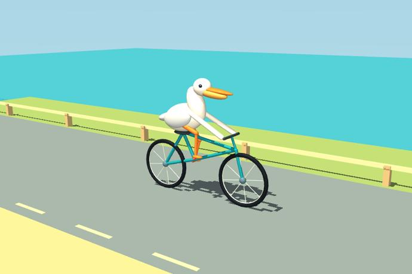
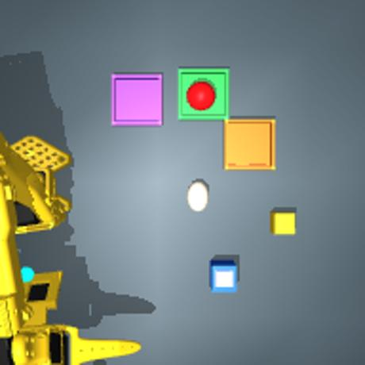

# MuJoCo Robotics Studio

在同一个原生 MuJoCo Studio 窗口中运行 12 个仿真场景。机器人实验使用 OpenAI Responses API 的 `gpt-6.2-sol`（`high`）定位目标、选择动作策略。本机负责 RGB-D 深度投影、逆运动学、接触物理、力反馈和任务评分。鹈鹕骑行可离线运行。



## 实验

| Studio 实验 | 内容 |
|---|---|
| SO-101 随机红方块抓取 | 重跑随机改变方块位置，重新定位并抓取。 |
| FR3 Duo 双臂咖啡店 | 取杯、注液、送托盘，检查夹持、碰撞与泼洒。 |
| YAM Pro 曲奇分拣 | 输送两类曲奇，逐件停带识别并放进对应料盒。 |
| SO-101 杂货分拣 | 随机摆放三类杂货，按类入盒，监测易碎鸡蛋的夹持力和冲击。 |
| 鹈鹕骑自行车 | 曲柄驱动后轮，检查行驶距离、轮地接触和滑移。 |
| Gauntlet 方块入碗 | 抓放目标方块并监测旁边物体。 |
| Gauntlet 插销入孔 | 力反馈对准与插入，记录轴向载荷和侧向载荷。 |
| Gauntlet 双块堆叠 | 抓放并检查堆叠稳定性，抓取失败可重定位。 |
| SO-101 横向插 U 盘 | 对准侧面插口，沿水平方向插入。 |
| SO-101 给记号笔套盖 | 定位固定笔杆，将空心盖套到笔杆上。 |
| SO-101 三块堆叠 | 先放绿块，再放蓝块，分别请求新的视觉决策。 |
| SO-101 香蕉入碗 | 抓住弯曲物体的中段，检查整根香蕉是否稳定落入碗内。 |



## Windows 安装与启动

需要 Git 和 Python 3.12。在仓库目录运行 PowerShell 命令。

```powershell
py -3.12 -m venv .venv
.\.venv\Scripts\python.exe -m pip install -r requirements.txt
git clone --filter=blob:none --no-checkout --sparse https://github.com/google-deepmind/mujoco_menagerie.git .menagerie
git -C .menagerie sparse-checkout set robotstudio_so101 franka_fr3_duo robotiq_2f85 i2rt_yam
git -C .menagerie checkout --detach eea4c7431b63da8278b0ff31638e0b0e941cec0e
.\.venv\Scripts\python.exe examples/studio.py
```

在 **Robotics Experiments** 面板选择场景，点 **Run / rerun** 开始一轮。面板底部的相机按钮可以切换视角。可用 `--experiment grocery_sort` 或 `--experiment pelican_ride` 直接打开对应场景。实验记录保存在本机的 `runs/studio-experiments/`。

## OpenAI API

需要在线视觉时，从设置了 `OPENAI_API_KEY` 的终端启动 Studio。随仓库提供的 [配置模板](.env.example) 保持空白，程序从进程环境读取配置。模型只接收当前模拟相机 RGB 画面和任务提示，并返回结构化目标区域及动作策略。无密钥时仍可打开和切换场景，可运行离线骑行；启动在线视觉会显示配置提示。

## 验证

```powershell
.\.venv\Scripts\python.exe -m unittest discover -s tests
.\.venv\Scripts\python.exe examples/pelican_ride.py --output runs/pelican-check
```

离线测试覆盖 Responses 请求格式、空配置、鉴权错误和定位结果校验。此前仿真记录包括杂货分拣两轮各 3/3、YAM Pro 曲奇分拣两轮各 6/6、四项精细操作通过 Gauntlet 基线，以及骑行 9 秒行驶 9.26 米。更换认证后的在线推理可由使用者配置 API 项目后运行。

## 来源与许可

本项目改编自 [Google DeepMind Robotics Antigravity Plugin](https://github.com/google-deepmind/robotics-antigravity-plugin/tree/3dde338)。保留上游版权声明和 [Apache 2.0 许可](LICENSE)。机器人模型通过 [MuJoCo Menagerie](https://github.com/google-deepmind/mujoco_menagerie) 下载，各模型的许可证随同上游资产提供。
